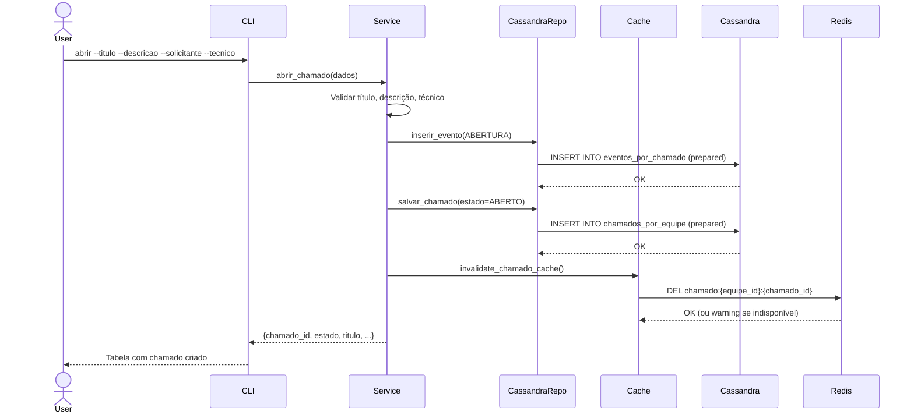
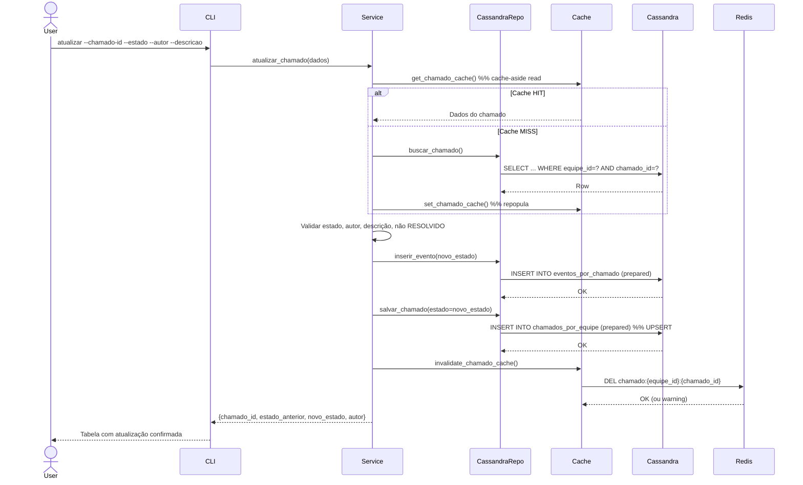
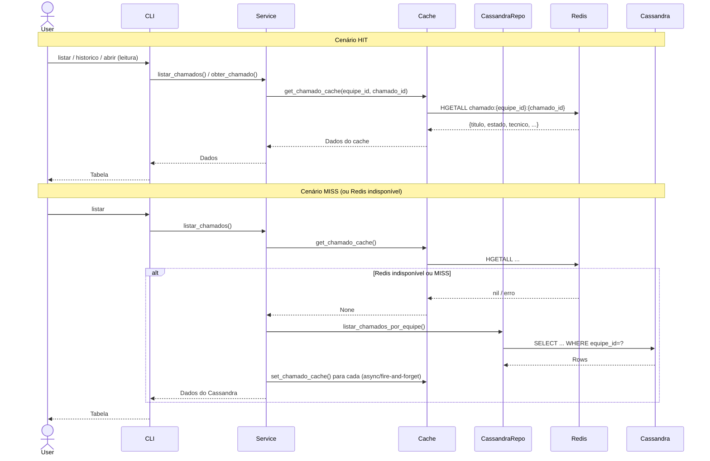

# Documentação Final - VigiaTI (Marco 2)

**Disciplina:** Bancos de Dados NoSQL: Persistência e Distribuição de Big Data  
**Instituição:** CEUB - Campus Taguatinga  
**Data:** Novembro 2026  
**Versão:** 2.0.0 (Marco 2)

---

## 1. Descrição do Problema

### 1.1 Contexto
Solicitações de suporte de TI ficam dispersas entre mensagens instantâneas, e-mails e planilhas, dificultando:
- Saber o responsável atual pelo atendimento
- Consultar a situação do chamado (aberto, em atendimento, resolvido)
- Acessar o histórico completo de ações realizadas

O **VigiaTI** centraliza os chamados e preserva todas as ações anteriores, fornecendo rastreabilidade completa.

### 1.2 Requisitos Funcionais (RF01–RF04)

| ID | Operação | Comportamento |
|----|----------|---------------|
| **RF01** | Abrir | Registrar título, descrição, solicitante e técnico; estado inicial `ABERTO`; gravar evento de abertura |
| **RF02** | Listar | Mostrar chamados de uma equipe com estado e data de abertura |
| **RF03** | Atualizar | Alterar estado para `EM_ATENDIMENTO` ou `RESOLVIDO` e registrar a ação como evento |
| **RF04** | Histórico | Mostrar eventos de um chamado do mais recente ao mais antigo, com autor e instante |

### 1.3 Regras de Negócio
- Título e descrição **obrigatórios** na abertura
- **Três estados apenas**: `ABERTO`, `EM_ATENDIMENTO`, `RESOLVIDO` — qualquer outro valor é rejeitado
- Cada chamado tem **ID próprio (uuid)**; cada evento tem **ID e instante próprios (timeuuid)**
- **Eventos nunca são apagados**. Alterar estado **acrescenta** um evento e atualiza o estado exibido na listagem
- `RESOLVIDO` **encerra** o atendimento (sem reabertura); atualizar chamado já resolvido é rejeitado
- Equipe e técnicos são **pré-cadastrados e fictícios** (sem login, permissões ou dados pessoais reais)

### 1.4 Fora de Escopo (Não Implementado)
Reabertura, prioridade, anexos, SLA, notificações, ranking, busca textual, relatórios, consultas globais por estado, controle de acesso entre organizações, auditoria de produção, ordenação de negócio entre técnicos concorrentes, tolerância a falhas de nó, atualização atômica entre tabelas.

### 1.5 Volume Estimado (Dados de Demonstração)
- **~1.000 chamados** (seed)
- **~10 eventos por chamado** (abertura + ~9 ações)
- **~10.000 eventos totais** × ~1 kB ≈ **10 MB brutos** (sem índices, metadados e backups)
- Uma equipe de demonstração com UUID fixo e técnicos `Tec01`, `Tec02`, `Tec03`

### 1.6 Evolução desde o Marco 1
| Aspecto | Marco 1 | Marco 2 |
|---------|---------|---------|
| Persistência | Em memória / arquivos | **Cassandra (Wide-Column) + Redis (Chave-Valor)** |
| Modelagem | Não formalizada | **Query-first**, CQL, tabelas particionadas |
| Cache | Não existia | **Cache-aside com TTL 60s, invalidação, tolerância a falha** |
| Regras de negócio | Básicas | **Completas (validações, estados, reconciliação)** |
| CLI | Simples | **Completa (init, seed, abrir, listar, atualizar, historico, reconciliar, limpar)** |
| Testes | Não existiam | **8 testes de integração (pytest, fixtures com limpeza)** |
| Documentação | Básica | **Arquitetura, modelagem, decisões justificadas, CAP, ACID/BASE, sharding, replicação** |

---

## 2. Arquitetura

### 2.1 Diagrama de Componentes

```mermaid
graph TB
    subgraph "Aplicação (Python 3.11+)"
        CLI[CLI / argparse]
        Service[Service Layer<br/>Regras de negócio RF01-RF04]
        CassandraRepo[Cassandra Repository<br/>Prepared Statements]
        Cache[Cache Layer<br/>Redis Hash + TTL 60s]
    end

    subgraph "Cassandra (Wide-Column)"
        KS[(Keyspace: vigiati)]
        T1[chamados_por_equipe<br/>PK: (equipe_id), chamado_id]
        T2[eventos_por_chamado<br/>PK: (chamado_id), evento_id DESC]
    end

    subgraph "Redis (Chave-Valor)"
        RH[Hash: chamado:{equipe_id}:{chamado_id}<br/>TTL: 60s]
    end

    CLI --> Service
    Service --> CassandraRepo
    Service --> Cache
    CassandraRepo --> KS
    KS --> T1
    KS --> T2
    Cache --> RH

    style Service fill:#e1f5fe
    style Cache fill:#fff3e0
    style T1 fill:#f3e5f5
    style T2 fill:#f3e5f5
    style RH fill:#fff3e0
```

### 2.2 Diagrama de Sequência - RF01: Abrir Chamado



### 2.3 Diagrama de Sequência - RF03: Atualizar Estado



### 2.4 Diagrama de Sequência - Leitura com Cache (Hit e Miss)



---

## 3. Modelagem Final

### 3.1 Cassandra (Wide-Column, Query-First)

```sql
CREATE KEYSPACE IF NOT EXISTS vigiati
  WITH replication = {'class': 'SimpleStrategy', 'replication_factor': 1};

CREATE TABLE IF NOT EXISTS chamados_por_equipe (
  equipe_id uuid,
  chamado_id uuid,
  criado_em timestamp,
  titulo text,
  descricao text,
  solicitante text,
  tecnico text,
  estado text,
  PRIMARY KEY ((equipe_id), chamado_id)
);

CREATE TABLE IF NOT EXISTS eventos_por_chamado (
  chamado_id uuid,
  evento_id timeuuid,
  tipo text,
  descricao text,
  autor text,
  PRIMARY KEY ((chamado_id), evento_id)
) WITH CLUSTERING ORDER BY (evento_id DESC);
```

#### Decisões de Modelagem

| Tabela | Partition Key | Clustering Columns | Justificativa |
|--------|---------------|-------------------|---------------|
| `chamados_por_equipe` | `equipe_id` | `chamado_id` | RF02: listar chamados de **uma equipe**. Partição por equipe garante que a consulta toque apenas uma partição. |
| `eventos_por_chamado` | `chamado_id` | `evento_id` (DESC) | RF04: histórico do **mais recente ao mais antigo**. `timeuuid` garante ordenação temporal e unicidade. |

> **Sem junções e sem `ALLOW FILTERING`**. Todas as consultas usam **prepared statements** (nunca concatenação de strings em CQL).

#### Ordenação por `criado_em` na Aplicação
A listagem por equipe (RF02) é ordenada por `criado_em` **na aplicação** (partição pequena na escala de teste), com paginação via `fetch_size` / `--limite`.

**Limitação declarada:** `chamado_id` (uuid) como clustering column **não dá ordem temporal**. Em escala maior, particionar também por período (ex.: bucket mensal na partition key: `((equipe_id, bucket_mes), chamado_id)`) e usar `timeuuid`/`criado_em` como clustering column.

#### Estratégia de Replicação
`SimpleStrategy` com fator 1 é **só para o nó único local**. Em produção seria `NetworkTopologyStrategy` com fator 3.

### 3.2 Redis (Chave-Valor)

**Estrutura:** Hash `chamado:{equipe_id}:{chamado_id}`

```redis
HSET chamado:00000000-0000-0000-0000-000000000001:ec33d4e3-dfaf-4657-9611-1a36ba1f6950 \
  titulo "Falha na rede Wi-Fi" \
  estado "EM_ATENDIMENTO" \
  tecnico "Tec01" \
  solicitante "Ana Silva" \
  descricao "Usuários sem conexão..." \
  criado_em "2026-11-23T22:38:50.551815+00:00"
EXPIRE chamado:00000000-0000-0000-0000-000000000001:ec33d4e3-dfaf-4657-9611-1a36ba1f6950 60
```

**Campos armazenados:** `titulo`, `estado`, `tecnico`, `solicitante`, `descricao`, `criado_em` — tudo o que é útil ao resumo na listagem.

**TTL:** 60 segundos (configurável).

**Política:** **Cache-aside** (lazy loading)
- **Leitura:** Tenta Redis → se miss ou falha, lê Cassandra → repovoa cache
- **Escrita:** Após confirmação no Cassandra, **remove** a chave (invalidação)
- **Redis NUNCA guarda a única cópia**. Com Redis fora do ar, sistema continua (log de aviso, sem exceção ao usuário)

### 3.3 Exemplos Concretos de Linhas e Chaves

#### Cassandra - `chamados_por_equipe`
| equipe_id | chamado_id | criado_em | titulo | descricao | solicitante | tecnico | estado |
|-----------|------------|-----------|--------|-----------|-------------|---------|--------|
| 0000...0001 | a1b2...7890 | 2026-11-23 10:00:00 | Falha na rede Wi-Fi | Usuários sem conexão... | Ana Silva | Tec01 | ABERTO |

#### Cassandra - `eventos_por_chamado` (ordenado DESC por `evento_id`)
| chamado_id | evento_id (timeuuid) | tipo | descricao | autor |
|------------|----------------------|------|-----------|-------|
| a1b2...7890 | b2c3...9012 | EM_ATENDIMENTO | Iniciando diagnóstico | Tec01 |
| a1b2...7890 | a1b2...7890 | ABERTURA | Chamado aberto: Falha na rede... | Ana Silva |

#### Redis - Hash
```
Key: chamado:00000000-0000-0000-0000-000000000001:a1b2c3d4-e5f6-7890-abcd-ef1234567890
Value: {
  "titulo": "Falha na rede Wi-Fi",
  "estado": "ABERTO",
  "tecnico": "Tec01",
  "solicitante": "Ana Silva",
  "descricao": "Usuários sem conexão...",
  "criado_em": "2026-11-23T10:00:00.000000"
}
TTL: 60s
```

---

## 4. Quadro Consulta × Tabela

| Requisito | Operação | Tabela Cassandra | Partition Key | Clustering | Filtro | ALLOW FILTERING? |
|-----------|----------|------------------|---------------|------------|--------|------------------|
| **RF01** | Inserir chamado | `chamados_por_equipe` | `equipe_id` | `chamado_id` | — | Não |
| **RF01** | Inserir evento abertura | `eventos_por_chamado` | `chamado_id` | `evento_id` (DESC) | — | Não |
| **RF02** | Listar por equipe | `chamados_por_equipe` | `equipe_id` | `chamado_id` | `equipe_id = ?` | Não |
| **RF03** | Ler chamado p/ validação | `chamados_por_equipe` | `equipe_id` | `chamado_id` | `equipe_id = ? AND chamado_id = ?` | Não |
| **RF03** | Inserir evento atualização | `eventos_por_chamado` | `chamado_id` | `evento_id` (DESC) | — | Não |
| **RF03** | Atualizar linha chamado | `chamados_por_equipe` | `equipe_id` | `chamado_id` | `equipe_id = ? AND chamado_id = ?` | Não |
| **RF04** | Histórico por chamado | `eventos_por_chamado` | `chamado_id` | `evento_id` (DESC) | `chamado_id = ?` | Não |
| **Reconciliar** | Ler eventos | `eventos_por_chamado` | `chamado_id` | `evento_id` (DESC) | `chamado_id = ?` | Não |
| **Reconciliar** | Ler/Atualizar chamado | `chamados_por_equipe` | `equipe_id` | `chamado_id` | `equipe_id = ? AND chamado_id = ?` | Não |
| **Cache** | Hit/Miss/Invalidação | Redis Hash | `chamado:{equipe_id}:{chamado_id}` | — | Chave exata | N/A (KV) |

> **Todas as consultas Cassandra usam prepared statements** (ver `cassandra_repo.py`). Nenhuma usa `ALLOW FILTERING`.

---

## 5. Justificativa Tecnológica, por Unidade

### 5.1 Limites do Relacional

**Admissão:** Para 1.000 chamados e ~10.000 eventos, um banco relacional (PostgreSQL, MySQL) **bastaria** — joins simples, transações ACID, ferramentas maduras.

**Por que NoSQL então? Projeção de crescimento:**
- **Milhões de eventos** por mês (picos de escrita contínuos)
- **Múltiplas equipes** (particionamento horizontal natural por `equipe_id`)
- **Custo de joins** `chamados ↔ eventos` em escala: índices grandes, lock contention, vacuum
- **Transações distribuídas** ao escalar horizontalmente (sharding manual ou Citus) adicionam latência e complexidade operacional

**Contrapartida:** Consultas não previstas (ex.: "todos os chamados do técnico X no mês Y") exigem **novas tabelas** (desnormalização intencional) ou mudança de modelo — trade-off consciente do *query-first*.

---

### 5.2 Teorema CAP

**Orientação: AP (Disponibilidade + Tolerância a Partição)**

**Justificativa pelo cenário:**
- Chamados de TI **toleram leitura levemente desatualizada** (cache 60s, replicação eventual)
- **Indisponibilidade total** (sistema parado) é pior que **inconsistência temporária** (técnico vê estado antigo por alguns segundos)
- Escritas (abertura/atualização) são críticas → Cassandra garante durabilidade no coordinator node; réplicas propagam assincronamente

**Não demonstrado no protótipo:** Nó único (`replication_factor=1`) não exerce tolerância a partição. A arquitetura **prevê** AP; a demonstração valida o modelo de dados e cache, não a resiliência de cluster.

---

### 5.3 ACID vs. BASE

| Propriedade | O que tem | O que NÃO tem (BASE / Eventual) |
|-------------|-----------|----------------------------------|
| **Atomicidade** | Por operação individual (INSERT no Cassandra é atômico por partição) | **Entre tabelas** (`eventos_por_chamado` + `chamados_por_equipe`) e **entre Cassandra ↔ Redis** |
| **Consistência** | Strong consistency por partição (QUORUM configurável) | **Cache**: *soft state* (TTL 60s, pode servir dado velho); **Réplicas**: eventual (se RF>1) |
| **Isolamento** | Row-level isolation no Cassandra | Sem isolamento entre operações concorrentes no mesmo chamado (last-write-wins por timestamp) |
| **Durabilidade** | Commit log + memtable + SSTables | Cache é volátil (Redis), perda de cache não perde dados |

**Ponto crítico:** A **ordem de escrita** (evento → chamado → invalida cache) não é atômica. Falha entre 1 e 2 gera divergência → **reconciliação manual** (`reconciliar <chamado_id>`). Não há promessa de recuperação automática.

---

### 5.4 Sharding

**Estratégia: Hash (Partitioner Murmur3 do Cassandra)** sobre `equipe_id` e `chamado_id`.

| Estratégia | Vantagens | Desvantagens | Por que NÃO usada |
|------------|-----------|--------------|-------------------|
| **Hash (Murmur3)** | Distribuição uniforme, sem hotspots, determinístico, sem serviço extra | Range scans ineficientes (não precisamos) | — |
| **Range** | Range scans eficientes | **Hotspots** (equipes novas concentram escritas), rebalanceamento complexo | Acesso é sempre por `equipe_id` exato (point lookup) |
| **Directory-based** | Controle explícito | **Ponto extra de falha** (serviço de diretório), latência extra, complexidade operacional | Overkill para particionamento por tenant/equipe |

**No protótipo:** Nó único → todo dado no mesmo nó. Em cluster, `equipe_id` como partition key garante que **uma equipe = uma partição** (ou poucas, se houver buckets temporais), distribuindo carga entre nós via hash.

---

### 5.5 Replicação

#### Cassandra
- **Topologia:** Peer-to-peer, **sem líder fixo** (próximo de *Master-Master* lógico)
- **Réplicas:** 3 (produção) com `NetworkTopologyStrategy` (1 por DC/rack)
- **Consistência ajustável:** `LOCAL_QUORUM` (2 de 3 no DC local) para escrita/leitura forte; `ONE` para latência mínima
- **Reparo:** `nodetool repair` (anti-entropy), *read repair* opcional

#### Redis
- **Topologia:** Primário + Réplica(s) (**Master-Slave**)
- **Replicação:** Assíncrona (padrão) ou síncrona com `WAIT`
- **Failover:** Sentinel ou Redis Cluster (sharding + réplicas)
- **Nota:** No protótipo, nó único. Cache é **descartável** — perda de réplica não afeta dado canônico (Cassandra).

> **Declarado:** São **propostas de evolução**, não comprovadas localmente (nó único).

---

### 5.6 Chave-Valor (Unidade 2) - Redis Hash + TTL

**Por que Hash (não String/JSON)?**
- **Resumo com vários campos** por chave única (`titulo`, `estado`, `tecnico`, `solicitante`, `descricao`, `criado_em`)
- **Atualização parcial** (`HSET` campos individuais) — embora no cache-aside façamos invalidação total (DEL), o Hash permite evoluir para *write-through* parcial no futuro
- **Estrutura nativa** — sem serialização JSON, leitura direta de campos

**Por que Cache-Aside (Lazy Loading)?**
- **Simplicidade:** Aplicação controla quando popular
- **Resiliência:** Falha no Redis não derruba leitura (fallback Cassandra)
- **TTL curto (60s):** Aceitável para listagem de chamados; dados "quentes" (abertos/em atendimento) são relidos frequentemente
- **Invalidação explícita** na escrita garante consistência *eventual* bounded pelo TTL

---

### 5.7 Wide-Column (Unidade 3) - Query-First no Cassandra

| Conceito | Aplicação no VigiaTI |
|----------|---------------------|
| **Famílias de colunas** | `chamados_por_equipe` e `eventos_por_chamado` são *column families* (tabelas CQL) |
| **Partition Key** | `equipe_id` / `chamado_id` — define distribuição e localidade de consulta |
| **Clustering Columns** | `chamado_id` (único por partição) / `evento_id` (timeuuid, DESC = ordem temporal) |
| **Query-First** | Tabelas desenhadas **exclusivamente** para RF02 (listar por equipe) e RF04 (histórico por chamado) |
| **Desnormalização** | Dados do chamado duplicados na tabela de eventos? **Não** — eventos guardam só o necessário (`tipo`, `descricao`, `autor`); detalhes ficam na tabela principal |
| **Sem índice secundário** | Evitado por performance/escala; nova tabela se novo acesso for necessário |

---

### 5.8 Por Que Só Duas Famílias NoSQL?

| Família | Uso no VigiaTI | Onde Entraria na Evolução |
|---------|----------------|---------------------------|
| **Wide-Column (Cassandra)** | **Core**: listagem por equipe + histórico por chamado (RF02, RF04) | — |
| **Chave-Valor (Redis)** | **Cache**: resumo de chamados para listagem rápida (RF02) | — |
| **Documentos (MongoDB, Couchbase)** | — | **Detalhes semiestruturados do chamado**: anexos (metadados), campos customizados por tipo de chamado, formulários dinâmicos, *checklists* de resolução, logs estruturados de diagnóstico. Vantagem: schema flexível por documento, queries ad-hoc em campos internos. |
| **Grafos (Neo4j, JanusGraph)** | — | **Relações entre chamados, técnicos e ativos**: *chamados duplicados/relacionados*, *dependências entre ativos* (servidor → aplicação → banco), *colaboração entre técnicos* (quem já atendeu o quê), *propagação de incidente* (raiz → afetados). Vantagem: travessia de relacionamentos profundos, padrões de co-ocorrência. |

**Decisão:** O domínio **atual** (CRUD de chamado + histórico linear) é **bem atendido** por Wide-Column (consultas por partition key) + Chave-Valor (cache). Documentos e Grafos resolvem problemas que **ainda não existem** no escopo — YAGNI.

---

## 6. Decisões Revisadas e Alternativas Descartadas

| Decisão | Alternativa Considerada | Por que Descartada |
|---------|------------------------|-------------------|
| **Ordenação por `criado_em` na aplicação** | Bucket mensal na partition key: `((equipe_id, bucket_mes), criado_em, chamado_id)` com clustering `criado_em` | Complexidade extra no seed, CLI, reconciliação; desnecessário para 1.000 chamados. Documentado como evolução. |
| **`timeuuid` no clustering de `chamados_por_equipe`** | Usar `timeuuid` como `chamado_id` (gerado na abertura) → ordenação temporal nativa | `chamado_id` já é UUID v4 (negócio); mudar para v1 acopla ID à geração de tempo. Mantido UUID v4 + ordenação app. |
| **Desnormalização em duas tabelas** | Índice secundário em `chamados_por_equipe.estado` para "listar abertos" | Índices secundários no Cassandra não escalam (varredura em todas as partições). Nova tabela `chamados_por_equipe_estado` se necessário. |
| **Atualização atômica entre tabelas** | *Batch statements* (logged/unlogged) | Batch logged tem custo de performance; unlogged não garante atomicidade. Complexidade não justificada para protótipo. |
| **Cache write-through** | Atualizar Redis na escrita (além de invalidar) | Cache-aside + invalidação é mais simples e seguro (Redis nunca é fonte da verdade). Write-through adiciona latência e falha dupla. |

---

## 7. Limitações Declaradas

| Limitação | Impacto | Mitigação Futura |
|-----------|---------|------------------|
| **Sem tolerância a falhas comprovada** (nó único) | Cluster não testado; healthcheck apenas local | Subir cluster 3 nós, testar `LOCAL_QUORUM`, `nodetool repair`, kill node |
| **Sem atualização atômica entre tabelas** | Divergência possível entre `eventos_por_chamado` e `chamados_por_equipe` | Reconciliação manual (`reconciliar`); batch logged ou *saga* pattern |
| **Sem ordenação de negócio para concorrência** | Dois técnicos atualizam mesmo chamado → *last-write-wins* por timestamp | *Optimistic locking* com `IF estado = ?` (Cassandra LWT) ou fila de comandos |
| **Cache até 60s desatualizado** | Listagem pode mostrar estado antigo | TTL configurável; *write-through* para chamados críticos; *pub/sub* invalidação |
| **Reconciliação manual** | Requer intervenção humana | *Job* periódico que varre divergências (evento mais recente ≠ estado na tabela) |
| **Sem autenticação/autorização** | Dados fictícios, sem multi-tenancy real | Adicionar JWT/OIDC, *row-level security* por `equipe_id` |
| **Seed não idempotente** | `limpar` + `seed` recria tudo | Upsert com chaves determinísticas para reexecução segura |

---

## 8. Resultados dos Testes e Lições Aprendidas

### 8.1 Resumo dos Testes
**Total:** 8 testes — **Todos passaram** (modo mock: Cassandra/Redis em memória)

| Teste | RF/Regra Validada |
|-------|-------------------|
| `test_abrir_chamado_sucesso` | RF01 |
| `test_abrir_chamado_sem_titulo_ou_descricao` | Regra: obrigatórios |
| `test_atualizar_chamado_sucesso` | RF03 + invalidação cache |
| `test_estado_invalido_rejeitado` | Regra: 3 estados |
| `test_atualizar_chamado_resolvido_rejeitado` | Regra: sem reabertura |
| `test_historico_eventos` | RF04 (ordem DESC, timeuuid) |
| `test_cache_aside_e_invalidação` | Cache hit/miss/TTL/invalidação |
| `test_reconciliacao` | Recálculo estado a partir de eventos |

**Arquivo completo:** [`docs/resultados_testes.md`](resultados_testes.md)

### 8.2 Lições Aprendidas

1. **Mock mode é essencial para TDD** — Testes rodam em <3s sem Docker, validando lógica de negócio isolada de infraestrutura.
2. **Prepared statements evitam bugs sutis** — Tipagem de parâmetros (uuid, timestamp, timeuuid) previne erros de formatação CQL.
3. **Cache-aside com invalidação > write-through** — Mais simples, resiliente, e o TTL curto limita janela de inconsistência.
4. **`timeuuid` + `CLUSTERING ORDER BY DESC`** resolve ordenação temporal nativa sem coluna extra — uso correto do tipo nativo.
5. **Reconciliação como feature explícita** — Aceitar que divergência *pode* acontecer (sem atomicidade distribuída) e dar ferramenta para corrigir é mais honesto que prometer consistência forte onde não há.
6. **Documentação de decisões descartadas** vale tanto quanto as adotadas — Evita retrabalho e mostra maturidade arquitetural.
7. **Query-first dita o schema** — Tentar "modelar certo" sem conhecer as queries leva a tabelas que não servem para nada.

---

## 9. Referências (ABNT)

1. **CEUB.** *Enunciado da Disciplina: Bancos de Dados NoSQL: Persistência e Distribuição de Big Data*. Campus Taguatinga, 2026.

2. **APACHE CASSANDRA DOCUMENTATION.** *Data Definition (CQL)*. Disponível em: <https://cassandra.apache.org/doc/latest/cql/ddl.html>. Acesso em: nov. 2026.

3. **APACHE CASSANDRA DOCUMENTATION.** *Data Modeling*. Disponível em: <https://cassandra.apache.org/doc/latest/cql/data-modeling.html>. Acesso em: nov. 2026.

4. **APACHE CASSANDRA DOCUMENTATION.** *Architecture Overview: Partitioning, Replication, Consistency*. Disponível em: <https://cassandra.apache.org/doc/latest/architecture/>. Acesso em: nov. 2026.

5. **REDIS DOCUMENTATION.** *Hash Commands: HSET, HGETALL, HGET, DEL*. Disponível em: <https://redis.io/commands/?group=hash>. Acesso em: nov. 2026.

6. **REDIS DOCUMENTATION.** *EXPIRE Command*. Disponível em: <https://redis.io/commands/expire/>. Acesso em: nov. 2026.

7. **REDIS DOCUMENTATION.** *Cache Patterns: Cache-Aside*. Disponível em: <https://redis.io/docs/latest/develop/use/patterns/caching/>. Acesso em: nov. 2026.

8. **DATASTAX.** *Data Modeling in Apache Cassandra™*. Whitepaper. 2023. Disponível em: <https://www.datastax.com/resources/whitepapers/data-modeling-in-apache-cassandra>. Acesso em: nov. 2026.

9. **BREWER, E.** *CAP Twelve Years Later: How the "Rules" Have Changed*. Computer, v. 45, n. 2, p. 23-29, 2012. DOI: 10.1109/MC.2012.37.

10. **PATERSON, R.; HÖLZLE, U.** *The Tail at Scale*. Communications of the ACM, v. 56, n. 2, p. 74-80, 2013. (Referência para latência em sistemas distribuídos / cache).

11. **MARTIN, K.** *Designing Data-Intensive Applications: The Big Ideas Behind Reliable, Scalable, and Maintainable Systems*. O'Reilly Media, 2017. Cap. 3 (Storage and Retrieval), Cap. 5 (Replication), Cap. 6 (Partitioning), Cap. 9 (Consistency and Consensus).

12. **CASSANDRA DRIVER PYTHON.** *Prepared Statements*. Disponível em: <https://docs.datastax.com/en/developer/python-driver/latest/features/prepared-statements/>. Acesso em: nov. 2026.

13. **REDIS PY (redis-py).** *Documentation*. Disponível em: <https://redis-py.readthedocs.io/>. Acesso em: nov. 2026.

---

---

**Fim da Documentação Final - VigiaTI Marco 2**